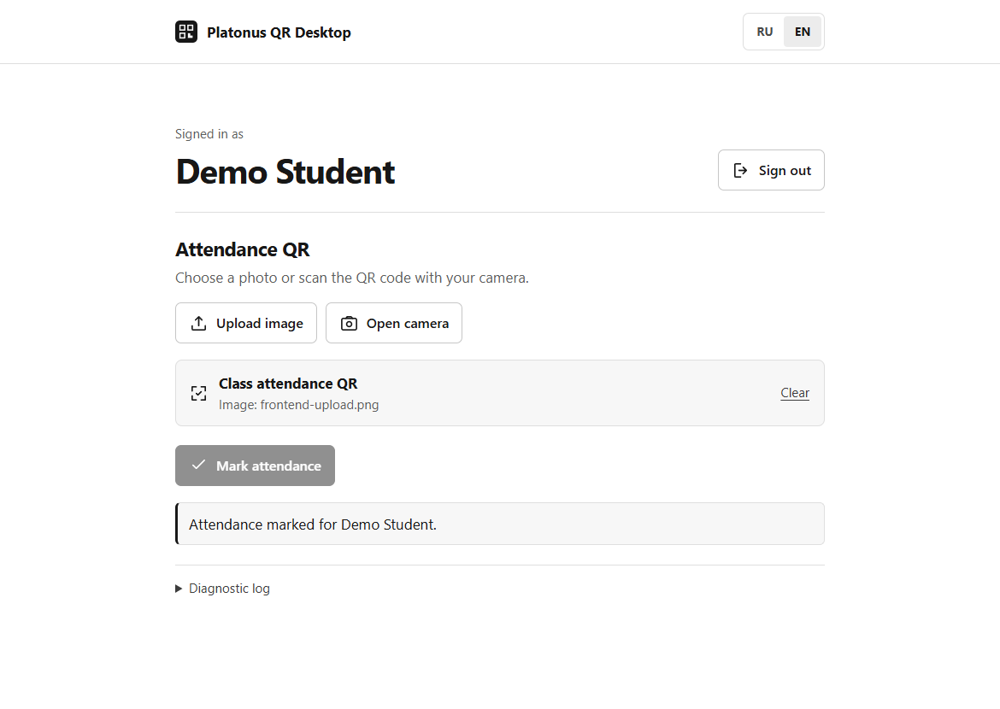

# Platonus QR Desktop

[Русский](README.md)

A desktop client for marking attendance in Platonus. Scan an instructor’s QR code in a browser or process it in a terminal. Check-ins use your student account and your university’s mobile API.

## Installation

Python 3.11 or later is required. Run these commands from the project directory.

### Windows (PowerShell)

```powershell
python -m venv .venv
.\.venv\Scripts\python.exe -m pip install -r requirements.txt
.\.venv\Scripts\python.exe -m platonus_desktop
```

### Linux

On Debian and Ubuntu, install Python and virtual environment support if needed.

```bash
sudo apt update
sudo apt install python3 python3-venv
```

Then create the environment and start the app.

```bash
python3 -m venv .venv
source .venv/bin/activate
python -m pip install -r requirements.txt
python -m platonus_desktop
```

For clipboard images, install `wl-clipboard` on Wayland or `xclip` on X11. Paste decoded QR text with the terminal’s usual paste shortcut.

## Web mode

The app opens `http://127.0.0.1:8765` by default. If the port is busy, it picks a free one and prints the address. Use `web --port 8766` to specify a port or `web --no-browser` to open the page manually.

1. Enter your university’s official HTTPS Platonus URL, username, and password. Verify the student name after signing in.
2. Upload a fresh QR image or open the camera and grant permission.
3. If coordinates are required, use the device’s location or place a pin on the map.
4. Click **Mark attendance**. Open the diagnostic log below the result for details.



The app chooses Russian or English based on the system language. Change it in the browser or pass `--lang ru` or `--lang en` before the mode name.

## Terminal mode

Run these commands with the virtual environment’s Python. On Windows, use `.\.venv\Scripts\python.exe` in place of `python` if needed.

```text
python -m platonus_desktop cli
python -m platonus_desktop cli --image qr.png
python -m platonus_desktop cli --clipboard
python -m platonus_desktop scan --image qr.png
```

In `cli` mode, enter the university address and your credentials, then paste the decoded QR as a single line. You can also copy a QR image and press Enter, or supply an image file. If coordinates are required, the CLI prompts for decimal latitude and longitude. The `scan` command only reads and prints the QR payload.

## Compatibility and implementation

The university must offer a compatible Platonus mobile API over public HTTPS. The client checks the sign-in settings before sending credentials. API versions and sign-in methods vary across universities. The university server controls QR expiration, location checks, and attendance decisions.

A local Python server serves the page. ZXing reads QR data from files or camera frames. The client sends the attendance code over HTTPS, along with user-selected coordinates when required, and displays the server’s result.

Passwords and session tokens are handled in memory. The server binds to loopback and protects its API with a temporary key. Diagnostics redact sensitive values. The map loads OpenStreetMap tiles when opened. [Tile usage policy](https://operations.osmfoundation.org/policies/tiles/).

For Python integrations, import `PlatonusClient` from `platonus_desktop.client` and `parse_qr` from `platonus_desktop.qr`. Both modes use the same client methods for login, profile lookup, location requirements, and submission.

## Tests

```text
python -m unittest discover -s tests -v
```

Tests use a mocked university server. A live test requires your own account and a valid QR.

## Disclaimer

This is an unofficial project. Use it in accordance with your university’s rules. The project and its features are provided as is, without warranties of compatibility, availability, or successful attendance submission. The authors disclaim liability for use of the project and its consequences to the extent permitted by applicable law.
