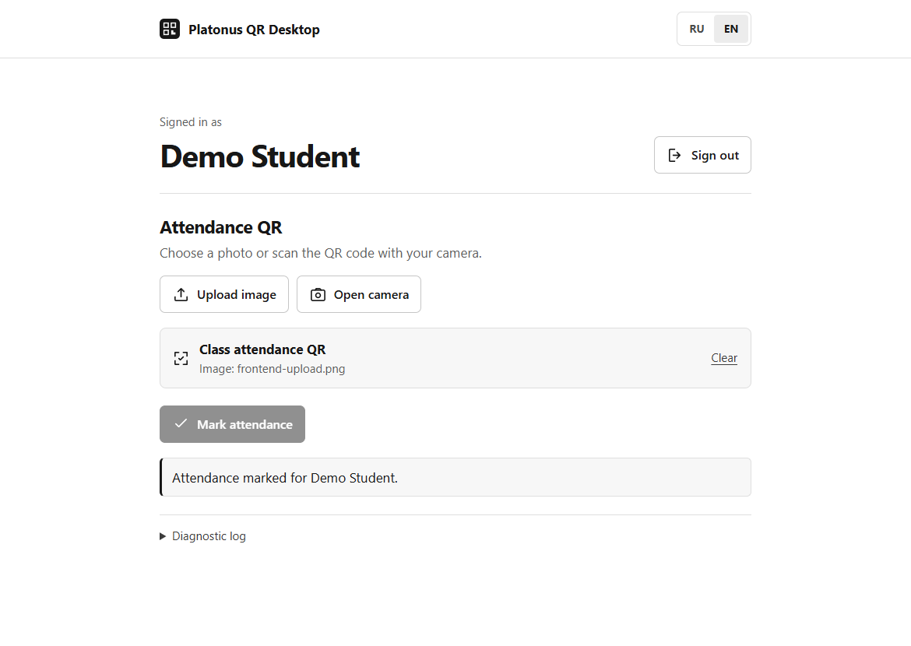

# Platonus QR Desktop

[English](README.en.md)

Клиент для отметки посещаемости в Platonus с компьютера. QR преподавателя можно считать в браузере или обработать в терминале. Для отметки используется учётная запись студента и мобильный API вуза.

## Установка

Нужен Python 3.11 или новее. Выполняйте команды из папки проекта.

### Windows (PowerShell)

```powershell
python -m venv .venv
.\.venv\Scripts\python.exe -m pip install -r requirements.txt
.\.venv\Scripts\python.exe -m platonus_desktop
```

### Linux

На Debian и Ubuntu установите Python и поддержку виртуальных окружений, если их ещё нет.

```bash
sudo apt update
sudo apt install python3 python3-venv
```

Затем создайте окружение и запустите приложение.

```bash
python3 -m venv .venv
source .venv/bin/activate
python -m pip install -r requirements.txt
python -m platonus_desktop
```

Для чтения изображений из буфера обмена на Linux установите `wl-clipboard` для Wayland или `xclip` для X11. Распознанный текст QR можно вставить обычным сочетанием клавиш в терминале.

## Веб-режим

По умолчанию приложение открывает `http://127.0.0.1:8765`. Если порт занят, оно выбирает свободный и печатает адрес в терминале. Указать порт вручную можно через `web --port 8766`, запустить без открытия браузера — через `web --no-browser`.

1. Введите официальный HTTPS-адрес Platonus своего вуза, логин и пароль. После входа проверьте имя студента.
2. Загрузите изображение свежего QR или откройте камеру и разрешите к ней доступ.
3. Если вуз требует координаты, используйте местоположение устройства или поставьте метку на карте.
4. Нажмите **Отметить посещаемость**. Под результатом можно раскрыть журнал диагностики.



Язык интерфейса определяется по настройкам системы. Переключить язык можно в браузере или аргументом `--lang ru` либо `--lang en` перед названием режима.

## Терминал

Используйте Python из созданного окружения. В Windows при необходимости подставьте `.\.venv\Scripts\python.exe` вместо `python`.

```text
python -m platonus_desktop cli
python -m platonus_desktop cli --image qr.png
python -m platonus_desktop cli --clipboard
python -m platonus_desktop scan --image qr.png
```

В режиме `cli` введите адрес вуза и данные для входа, затем вставьте распознанный текст QR в одну строку. Можно также скопировать изображение QR и нажать Enter или передать файл. Если требуются координаты, CLI попросит широту и долготу в десятичных градусах. Команда `scan` считывает и печатает содержимое QR.

## Совместимость и реализация

Вуз должен предоставлять совместимый мобильный API Platonus по публичному HTTPS-адресу. Перед отправкой данных для входа клиент проверяет настройки авторизации. Версии API и способы входа отличаются у разных вузов. Срок действия QR, геопроверку и результат отметки определяет сервер вуза.

Веб-страницу обслуживает локальный Python-сервер. ZXing считывает QR из файла или кадров камеры. Клиент отправляет код отметки выбранному серверу по HTTPS и выводит его ответ. Координаты передаются по требованию вуза.

Пароли и токены сессии обрабатываются в памяти. Веб-сервер слушает только loopback, а его API защищён временным ключом. Чувствительные значения удаляются из диагностики. Карта загружает тайлы OpenStreetMap при открытии. [Условия использования тайлов](https://operations.osmfoundation.org/policies/tiles/).

Для интеграции с другим Python-клиентом доступны `PlatonusClient` из `platonus_desktop.client` и `parse_qr` из `platonus_desktop.qr`. Клиент принимает адрес вуза, а его методы `login`, `get_profile`, `location_required` и `submit` используются в обоих режимах.

## Проверка

```text
python -m unittest discover -s tests -v
```

Тесты используют подставной сервер. Для проверки реального вуза нужны собственная учётная запись и действующий QR.

## Ответственность

Это неофициальный проект. Используйте его в соответствии с правилами своего вуза. Проект и его функции предоставляются «как есть», без гарантий совместимости, доступности или принятия отметки. Авторы не несут ответственности за использование проекта и его последствия в пределах, допускаемых применимым законодательством.
